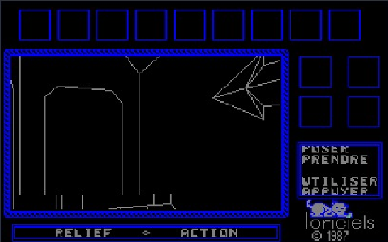
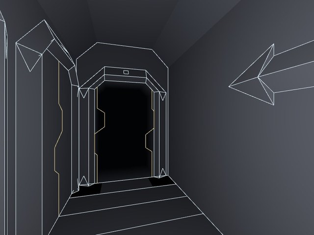
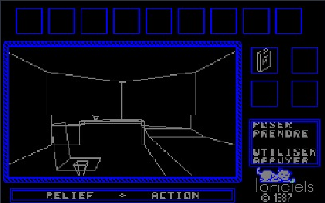
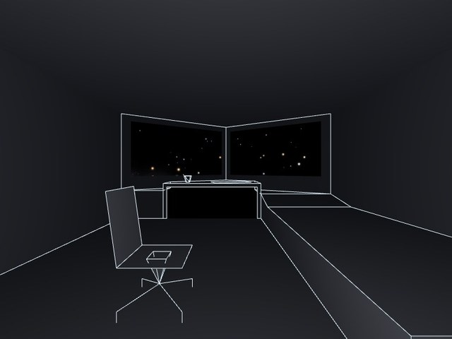
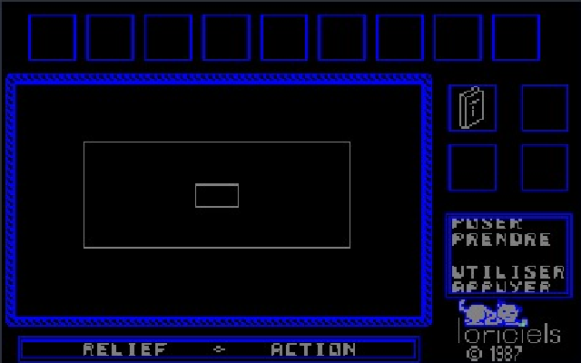
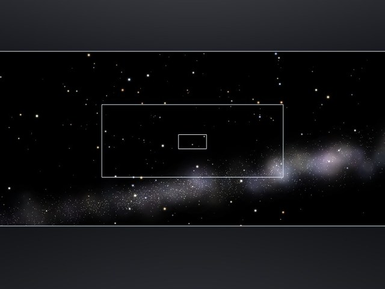
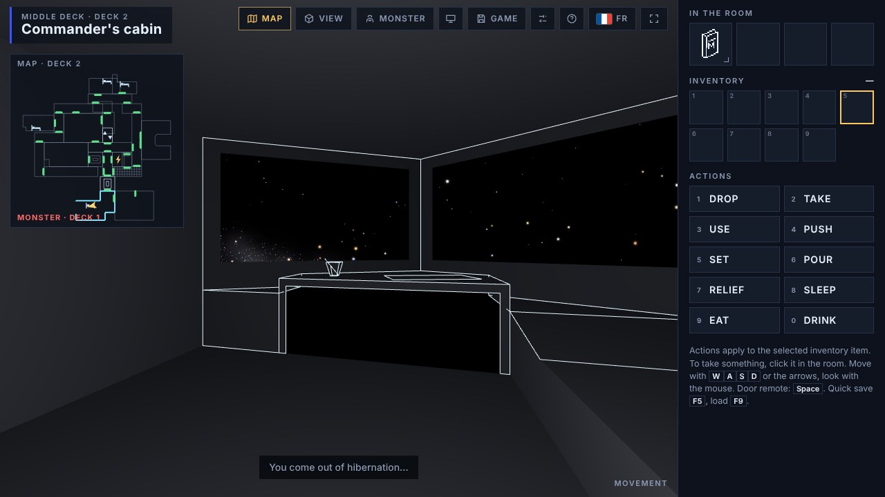

# Relief Action (Loriciels, 1987) — version modernisée

**▶ Jouer dans le navigateur : https://jaymanu79.github.io/relief-action/**

*Relief Action* est un jeu d'aventure en 3D fil de fer sorti sur Amstrad CPC en 1987 chez Loriciels.
Fiche du jeu sur CPC-Power : **https://www.cpc-power.com/index.php?page=detail&num=1783**

> **Diffusion autorisée.** Ce dépôt est publié avec l'accord écrit de l'un des auteurs originaux du jeu.

## L'histoire

Enfant, je bloquais dès le début de *Relief Action* : le monstre qui rôde dans le vaisseau était bien trop redoutable pour moi. Je n'ai jamais oublié ce jeu.

Il est pourtant resté méconnu : de l'aveu même de ses auteurs, il s'est peu vendu. Certains joueurs sont sans doute allés loin, comme le montrent les plans qu'on trouve encore, mais aucune solution complète n'a jamais été publiée. Il est donc fort probable que personne n'en ait vu la fin à 100 %.

J'ai passé des années à le rétro-ingénierer : extraire les textes, reconstituer les salles, désactiver le monstre pour enfin pouvoir avancer. Mais il me manquait les compétences en 3D pour aller au bout de mon idée. L'IA me l'a permis aujourd'hui : la géométrie du jeu est réimplémentée en WebGL, et le code d'origine tourne tel quel dans un émulateur Z80 écrit en JavaScript.

**Un trésor oublié qui sort aujourd'hui de l'ombre.**

| Amstrad CPC, 1987 | Version web |
|---|---|
|  |  |
|  |  |
|  |  |

Le jeu parle aussi espagnol grâce à **MiguelSky**, qui l'a entièrement traduit. Et ce n'est qu'un début : chacun peut proposer sa langue (voir [Traductions](#traductions)), je la compile ensuite à la fois pour la version web et pour la disquette CPC.

## Contenu

| Fichier | Contenu |
|---|---|
| `index.html` | Le jeu jouable dans le navigateur, en un seul fichier : le code original tourne dans un émulateur CPC, avec un rendu 3D modernisé (étoiles, transparences, plan, détecteur), en français, anglais ou espagnol. |
| `relief-action.dsk` | La disquette CPC enrichie : jeu, épilogue et démo en français, anglais et espagnol (langue au choix au lancement), trainer (temps infini, monstre endormi), correctif de sauvegarde Multiface / instantané d'émulateur. |
| `relief-action-plans.pdf` | Les plans vectoriels des trois ponts du vaisseau : salles, objets de départ, image du détecteur, départs du joueur et du monstre. |

## Traductions

Vous voulez jouer dans votre langue ? Proposez une traduction : je la compile pour la version web et pour la disquette CPC. Tout est expliqué dans [translations/](translations/README.md) : un seul fichier texte à remplir, puis une pull request.

## Compiler

Tout se reconstruit depuis les sources avec `sh build/build.sh` (Python 3) : voir [build/](build/README.md).

## Crédits

- Jeu original : Loriciels, 1987 — voir la [fiche CPC-Power](https://www.cpc-power.com/index.php?page=detail&num=1783).
- Versions modernisées : jaymanu, avec Claude (Anthropic).
- Traduction espagnole : MiguelSky.
- Diffusé avec l'accord écrit de l'un des auteurs originaux.

---

# English

**▶ Play in your browser: https://jaymanu79.github.io/relief-action/**

*Relief Action* is a 1987 wireframe 3D adventure game for the Amstrad CPC by Loriciels.
The game on CPC-Power: **https://www.cpc-power.com/index.php?page=detail&num=1783**

> **Authorised distribution.** This repository is published with the written permission of one of the game's original authors.

## The story

As a kid, I got stuck right at the start of *Relief Action*: the monster prowling the ship was far too tough for me. I never forgot this game.

Yet it remained little known: by its own authors' account, it sold poorly. Some players probably got far, judging by the maps that can still be found, but no complete walkthrough was ever published. Quite likely, nobody ever saw 100% of the ending.

I spent years reverse-engineering it: extracting the texts, rebuilding the rooms, disabling the monster so I could finally make progress. But I lacked the 3D skills to see my idea through. AI made it possible today: the game's geometry is reimplemented in WebGL, and the original code runs unmodified in a Z80 emulator written in JavaScript.

**A forgotten treasure, out of the shadows at last.**

| Amstrad CPC, 1987 | Web version |
|---|---|
|  |  |
|  |  |
|  |  |

The game also speaks Spanish, thanks to **MiguelSky**, who translated all of it. And that is just the beginning: anyone can propose their own language (see [translations/](translations/README.md)), and I will build it for both the web version and the CPC disk.

- `index.html` — the game, playable in the browser from a single file: the original code runs in a CPC emulator with a modernised 3D renderer (stars, windows, map, detector), in French, English or Spanish.
- `relief-action.dsk` — the enhanced CPC disk: game, epilogue and demo in French, English and Spanish (language chosen at startup), trainer (infinite time, sleeping monster), Multiface / emulator snapshot save fix.
- `relief-action-plans.pdf` — vector maps of the ship's three decks.

Want to translate the game into your language? See [translations/](translations/README.md): one text file to fill in, then a pull request.

Everything is rebuilt from the sources with `sh build/build.sh` (Python 3): see [build/](build/README.md).

Credits: original game by Loriciels (1987); modernised versions by jaymanu, with Claude (Anthropic); Spanish translation by MiguelSky; distributed with the written permission of one of the original authors.
